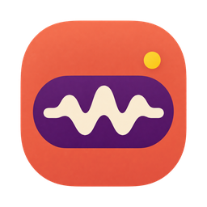

<p align="center"></p>

<h1 align="center">Handy Bar</h1>

<p align="center">Fast, private, on-device dictation that lives in your Mac's menu bar.<br>
<b>An unofficial fork of <a href="https://github.com/cjpais/handy">Handy</a>.</b></p>

---

Handy Bar is [Handy](https://github.com/cjpais/handy), the open source
speech-to-text app by CJ Pais, with its macOS interface rebuilt as a native
menu bar app. Press your shortcut, speak, and your words are typed where your
cursor is. Transcription runs on your Mac.

What's different from Handy:

- **Everything is in the menu bar.** Click the icon for a native popover with
  Home, History, Models and Settings. There's no settings window and no Dock
  icon.
- **Native and light.** The popover and the recording indicator are AppKit,
  drawn from Rust; there's no WebView running. Views exist only while the
  popover is open.
- **Live words in the indicator.** With "Levels + live text" and a streaming
  model (such as Parakeet Unified), the indicator shows your words as you
  speak.
- **AI cleanup with any command-line tool.** Besides Handy's AI providers,
  cleanup can run a command such as `claude -p --model haiku` or
  `codex exec`, using the subscription you already have. The command starts
  when you press the cleanup shortcut, so its start-up overlaps your
  speaking, and if it's slow, fails, or drops your words, your original text
  is pasted.

Windows and Linux builds are unchanged from Handy. This fork is not
affiliated with or endorsed by the Handy project; please report Handy Bar
issues here, not upstream.

## Install

There are no prebuilt releases yet, so build it yourself. It's developed and
tested on macOS 26 on Apple Silicon.

```bash
git clone https://github.com/thekindofme/Handy.git handy-bar
cd handy-bar
git checkout menubar-native
bun install
mkdir -p src-tauri/resources/models
curl -L -o src-tauri/resources/models/silero-vad-v6.2-F32.gguf \
  https://huggingface.co/handy-computer/silero-vad-v6.2-gguf/resolve/main/silero-vad-v6.2-F32.gguf
scripts/menubar/build-test-app.sh
open "src-tauri/target/debug/bundle/macos/Handy Bar.app"
```

See [BUILD.md](../BUILD.md) for toolchain setup. macOS ties Microphone and
Accessibility permissions to the app's signature, so set
`HANDY_SIGNING_IDENTITY` to a local code-signing identity if you rebuild
often; otherwise you'll be asked again after every build.

`build-test-app.sh` makes a quick **debug** build for development. Debug
builds log transcripts in plain text (Handy only hides them in release
builds), so for everyday use build a release instead:

```bash
CMAKE_POLICY_VERSION_MINIMUM=3.5 bun run tauri build --bundles app
open "src-tauri/target/release/bundle/macos/Handy Bar.app"
```

To run Handy's original WebView interface from the same build, start it with
`HANDY_WEBVIEW_UI=1`.

## Status

Working: dictation, live text, the recording indicator, model downloads,
history, microphone and output selection, shortcuts, AI cleanup (Handy's
providers or a command-line tool), and most settings. Either click on the
menu bar icon opens the popover; there's no separate right-click menu.

Not in the menu bar yet (use `HANDY_WEBVIEW_UI=1` for now): adding or
deleting cleanup prompts, fetching a provider's model list, custom words,
filler-word lists, debug tuning, and translations (the menu bar UI is
English only).

Update checks are turned off: Handy's updater would replace Handy Bar with
upstream Handy.

## Keeping up with Handy

The fork lives almost entirely in new files (`src-tauri/src/menubar/`,
`docs/menubar/`, `scripts/menubar/`), with small macOS-only hooks in three
upstream files, so upstream changes merge cleanly.

```bash
scripts/menubar/sync-upstream.sh
```

A weekly workflow also opens a pull request when Handy has new commits.
Design notes and architecture are in [docs/menubar](../docs/menubar/README.md).

## Credits and license

Handy Bar is built on [Handy](https://github.com/cjpais/handy) by CJ Pais and
its contributors, and keeps Handy's [MIT license](../LICENSE). The Handy Bar
name and icon are this fork's own; Handy's name and logo belong to the Handy
project.
