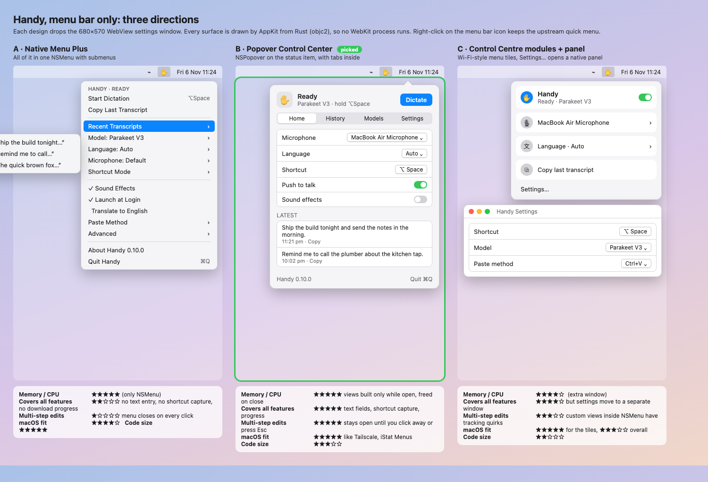

# Handy menu bar UI (macOS)

This fork replaces Handy's WebView settings window on macOS with a native
menu bar popover drawn by AppKit from Rust. Windows and Linux are unchanged.



## The three designs

`designs.html` (rendered to `designs.png`) shows three ways to fit all of
Handy into the menu bar. All three drop the WebView.

| | A · Native Menu Plus | **B · Popover Control Center** | C · Control Centre modules + panel |
|---|---|---|---|
| What it is | Everything in one `NSMenu` with submenus | `NSPopover` on the status item, with Home / History / Models / Settings tabs | Wi-Fi-style tiles in the menu, Settings… opens a native panel |
| Memory / CPU | Lowest | Low: views exist only while open | Low, plus a window |
| Covers every feature | No: no text entry, no shortcut capture, no download progress | Yes | Yes, but settings live in a separate window |
| Several changes in a row | Menu closes after every click | Stays open until you click away or press Esc | Tracking quirks with controls inside `NSMenu` |
| macOS fit | Good | Matches common menu bar apps (Tailscale, iStat Menus, 1Password mini) | Good for tiles, poor overall |

**Picked: B.** It is the only design that fits every feature in the menu bar
while staying fully native. It keeps Handy's upstream quick menu one click
away (right click), and it costs nothing when closed.

## macOS practices followed

- **Accessory app** (`ActivationPolicy::Accessory`): no Dock icon and no app
  switcher entry. Handy is in the menu bar only.
- **Transient `NSPopover`** anchored to the status item. It closes on an
  outside click or Esc, and ⌘Q in the popover quits. Left click opens it,
  right click keeps the classic menu.
- **Native controls only**: `NSSwitch`, `NSPopUpButton`, `NSSegmentedControl`,
  `NSProgressIndicator`, SF Symbols and system colors. Dark mode, accent
  color, vibrancy, Increase Contrast and Reduce Transparency all work for free.
- **Accessibility**: every control has an accessibility label and identifier.
  The end-to-end test drives the app through VoiceOver's own API.
- **Focus handling**: starting a dictation from the popover closes it and
  hands focus back to the app you were typing in, so the paste lands there.
- **Destructive actions** (Delete) use `hasDestructiveAction`.
- **No idle cost**: the view tree is built when the popover opens, redrawn
  only on state changes (coalesced, at most 4 per second while downloading),
  and freed when it closes.

## Architecture

```
src-tauri/src/menubar/
  view.rs     pure: app state (Snapshot) → Screen (rows, controls, actions)
  capture.rs  pure: handy-keys events → one shortcut
  mod.rs      gathers state, runs actions, listens for backend events
  appkit.rs   draws a Screen with AppKit (objc2) inside an NSPopover
```

The UI calls the same Rust functions the WebView's Tauri commands call
(`shortcut::change_*_setting`, `commands::models::*`, `commands::history::*`),
so behaviour matches upstream exactly.

## Staying compatible with upstream

- Everything new lives in `src-tauri/src/menubar/`. Upstream files change in
  small, `#[cfg(target_os = "macos")]`-guarded hooks: `lib.rs` (tray click,
  skip the WebView window and overlay, install) and `tray.rs` (expose the
  icon state and language list, redraw the popover when the tray updates).
- The React frontend is untouched and still ships. Set `HANDY_WEBVIEW_UI=1` to
  run the upstream WebView UI.
- To update from upstream: `git fetch upstream && git rebase upstream/main`.

## Not ported (yet)

These still need the WebView UI (`HANDY_WEBVIEW_UI=1`):

- Post-processing (LLM provider, API key, prompts)
- Custom words and filler-word lists
- Debug, log level, keyboard implementation and paste-delay tuning
- Translations: the popover's strings are English only for now

## Tests

- `cargo test --lib menubar`: unit tests for every screen, control and
  action, plus the shortcut-capture rules.
- `scripts/menubar/e2e/HandyMenubarE2E.swift`: drives the real app with real
  mouse and keyboard events, found through Accessibility. It checks each
  result in the UI, in the settings file Handy writes and, for dictation, in
  TextEdit.
